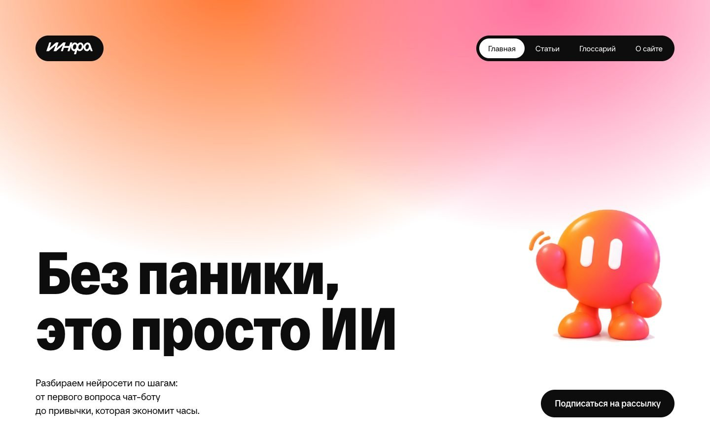

# ИИНФА

Медиа о нейросетях для миллениалов, поколения X и бумеров: понятным языком объясняем, что такое ИИ, как им пользоваться и как встроить его в работу и быт.

## Ссылки

- Сайт: [https://hseadc.github.io/pak/](https://hseadc.github.io/pak/)
- Макет в Figma: [ИИНФА](https://www.figma.com/design/8lkiZkYBcsNKAnT8dwdCbo/%D0%98%D0%98%D0%9D%D0%A4%D0%90?node-id=2-2&t=ZfLYfgBfAOcP4qFd-1)

## Скриншоты




## Команда

| Участник | Что делал(а)                                                                                              |
| -------- | --------------------------------------------------------------------------------------------------------- |
| Тарас    | Исследование, кастдев, философия проекта, презентации на старое и новое портфолио                         |
| Илья     | Верстка страниц "О нас", "Глоссарий", "Квизы", 404, настройка деплоя, маскот, адаптивы                    |
| Борис    | Создание дизайн-системы, верстка главной, страницы "Статьи" и всех статей, перенос макетов из Figma в код |

## Стек

- HTML, CSS, JavaScript без фреймворков
- Vite 6.4 — дев-сервер и сборка нескольких страниц
- PostCSS: postcss-nested, postcss-preset-env, autoprefixer
- Formspree — форма подписки
- Шрифты: RF Dewi Condensed Black (заголовки), TT Neoris Edu (текст)

## Как запустить локально

```bash
git clone https://github.com/HSEADC/pak.git
cd pak
npm install
npm run dev
```

Сборка для GitHub Pages попадает в папку `docs/`:

```bash
npm run build
```

## Структура проекта

```
src/                — исходники сайта, корень Vite
  index.html        — главная
  articles.html     — все статьи с фильтром по рубрикам
  article-*.html    — семь статей
  glossary.html     — глоссарий с фильтром по темам
  about.html        — о проекте и команде
  404.html          — страница не найдена
  stylesheets/      — main.css, все стили сайта
  scripts/          — index.js: фильтры, копирование запросов, глаза маскота на 404
  images/           — логотипы, архивные фото, credits.json с лицензиями
    mascot/         — 3D-маскот Гоша в разных позах
  fonts/            — файлы шрифтов
  ai/               — скриншоты для README и журнал работы с ИИ
  news/, skills/, interview/ — страницы-заглушки из стартового шаблона курса
docs/               — собранный сайт для GitHub Pages (создаёт npm run build)
vite.config.js      — список страниц для сборки и подключение скриптов
```

## Решения и сложности

- **Фильтры без фреймворков.** Фильтры статей и глоссария — несколько десятков строк на чистом JS через `data-rubric` и `data-tags`. При фильтрации сетка статей перестраивается из «мозаики» в ровные три колонки, иначе карточки ломали раскладку.
- **Делегирование задач ИИ.** Мы подумали, что стоит сделать сам сайт шоукейсом того, на что способны нейросети. Потому многие задачи (перенос макетов в код, alt подписи к картинкам, адаптивы) мы решили поручить ИИ.

## Использование ИИ

### Инструменты

| Инструмент и модель                 | Кто   | Для каких задач                                      | Уровень (0–4) |
| ----------------------------------- | ----- | ---------------------------------------------------- | ------------- |
| Claude Code, Claude Opus 5.5        | Борис | Код всех страниц                                     | 4             |
| Claude Code, Claude Opus 5.5        | Борис | Тексты семи статей, глоссарий, alt-тексты            | 3             |
| Claude Code + коннектор Figma (MCP) | Борис | Перенос макетов в код                                | 4             |
| Claude Code, скилл taste-skill      | Борис | Анализ сайта, проверка верстки и мобильного адаптива | 2             |
| GPT Image                           | Илья  | 3D-иллюстрации маскота                               | 4             |
| Claude Code, Claude Opus 5.5        | Илья  | Адаптивы, правка недочетов, страница 404             | 4             |

### Журнал запросов

### #4 · 26.10.2026 · Борис

- **Инструмент:** Claude Code, Claude Opus 5.5
- **Задача:** сверстать главную по макету: статьи карточками, квизы, глоссарий, светлая подписка, подвал с большим логотипом.
- **Запрос:** «подключись к figma, зайди в файл "ТИБЫ" и перенеси главную страницу в код, сохраняя структуру проекта»; затем картинки маскота: «Поставь машущего маскота на первый экран справа от заголовка».
- **Что выдал ИИ:** разметку и стили блоков; пока не было картинок — цветные плашки. Вставил присланные PNG маскота.
- **Что изменили и почему:** у PNG машущего маскота был белый непрозрачный фон — ИИ удалил его скриптом на Python (заливка от краёв). Под ногами осталась едва заметная светлая тень. Попросили сделать первый экран ровно в высоту окна и анимировать градиент.
- **Итог и проверка:** `src/index.html`, `src/stylesheets/main.css`, скриншоты на трёх ширинах.

### #5 · 26.10.2026 · Борис

- **Инструмент:** Claude Code, Claude Opus 5.5
- **Задача:** страницы «Статьи» и «Глоссарий» по макетам с фильтрами.
- **Запрос:** «теперь сделай страницу "статьи" и "глоссарий"».
- **Что выдал ИИ:** две страницы, фильтр по рубрикам и по темам на чистом JS (повторный клик снимает фильтр), 21 термин глоссария с определениями.
- **Что изменили и почему:** Длинный заголовок карточки «Первый разговор с чат-ботом по шагам» сократили, чтобы он помещался в две строки. В глоссарии исправили баг ИИ: стиль бежевых плашек перебивался общим правилом, пришлось поднять специфичность селектора.
- **Итог и проверка:** `src/articles.html`, `src/glossary.html`, `src/scripts/index.js`. Фильтр проверен в браузере: «Безопасность» оставляет 2 карточки из 8 и 2 термина из 21.

### #8 · 26.10.2026 · Борис

- **Инструмент:** Claude Code, Claude Opus 5.5
- **Задача:** тексты всех семи статей.
- **Запрос:** «сделай одну страничку-статью», затем «напиши все статьи из раздела "статьи"».
- **Что выдал ИИ:** шаблон статьи (содержание сбоку, готовые запросы с кнопкой «Скопировать», плашка «Важно», «Читайте также») и тексты семи статей. Страницы собраны Python-скриптом из одного шаблона.
- **Что изменили и почему:** **тексты статей полностью написаны ИИ**, даты и имена в примерах выдуманы. Проверка вёрстки ловила списки фраз в конце раздела как «подписи над заголовком» — после них добавили по предложению. Заголовки статей уменьшили, чтобы длинные названия влезали в две строки.
- **Итог и проверка:** `src/article-*.html`, скриншоты всех семи страниц на трёх ширинах.

### Рефлексия

Opus 5.5 хорошо справляется с написанием кода, сам замечает детали, которые легко упустить, но работа в Figma через MCP еще хромает. Пришли к выводу, что проще, быстрее и дешевле переносить макеты по экспортированным картинкам макета. Несмотря на хорошее написание кода, ИИ все еще упускает некоторые моменты по верстке, часто приходилось подправлять отступы, поэтому человеческий взгляд все еще нужен. Во время реализации этого проекта мы выстроили воркфлоу, который позволил нам сэкономить много времени. В целом, опыт вышел удачный, в следующем проекте сделаем все так же.
